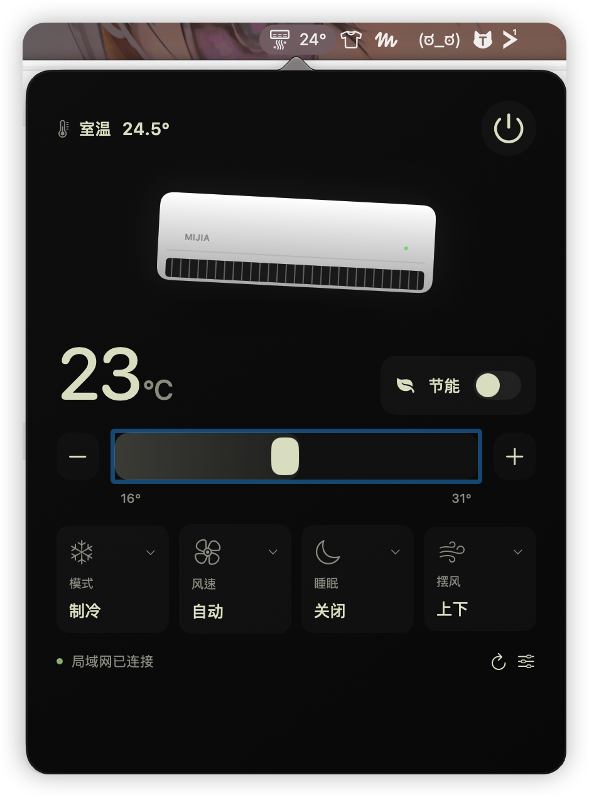

# 小米空调mac状态栏控制器

一个轻巧的 macOS 菜单栏米家空调控制器。SwiftUI 原生面板，Rust 通信核心，无 Python、Node.js 或后台服务器依赖。

> 开发中的 0.1 版本。当前只开放 `xiaomi.aircondition.c16`，不保证其他型号可用。尚未发布签名、公证的安装包。

## 实机截图



已连接空调的实际运行界面。

## 使用

1. 确保空调已经绑定米家，Mac 与空调处于可互通的局域网。
2. 启动应用，点击菜单栏空调图标 → **绑定米家空调**。
3. 选择与米家 App 一致的地区，点击 **用米家 App 扫码绑定**。
4. 用手机米家扫码，并确认登录。选择列表中的兼容空调。
5. 应用验证设备身份、读取状态后，将该设备密钥保存在 macOS 钥匙串。

不用查找或粘贴 Token。扫码会访问小米账号和米家服务；日常读取和控制直接使用局域网。小米账号登录凭据仅在配对进程内存中存在，不保留账号密码或云会话。未选设备的密钥不持久化。

支持开关、16–31℃（0.5℃步进）、制冷/制热/除湿/送风、自动/七档风速、节能、睡眠、上下摆风和室温显示。可选属性读取失败时，对应控件禁用。控制发出后重新读取设备状态，不以按钮点击当作成功。

离线时保留上次数据，显示连接失败并禁用控制。每 15 秒刷新一次；也可手动刷新。DHCP 地址变化后，在连接设置中重新扫码，或修改 IP 并验证保存。建议在路由器上为设备保留地址。

## 本地构建

需要 Apple Silicon Mac、macOS 14+、Swift 6.3 工具链和 Rust/Cargo。构建脚本不安装或升级系统工具。

```sh
./build.sh
open 'build/小米空调mac状态栏控制器.app'
```

构建输出为本机 ad-hoc 签名应用，不等于 Apple Developer ID 签名或公证。首次启动时若系统要求本地网络或钥匙串授权，需要允许才能连接。当前脚本仅构建 ARM64，不支持 Intel 构建产物。

```sh
./test.sh
cargo clippy --locked --manifest-path core/Cargo.toml -- -D warnings
xcrun swiftc -swift-version 6 -typecheck Sources/*.swift
```

`--preview` 启动仅有示例数据的界面预览，不读取凭据或访问空调；不要将预览当成实机验收。

## 结构

- `Sources/main.swift`：原生菜单栏、面板、绑定流程、钥匙串。
- `Sources/Contracts.swift`：独立的 Rust/Swift 通信数据结构。
- `Sources/Controls.swift`：带无障碍支持的原生交互控件。
- `core/src/main.rs`：miIO 握手、AES-CBC 加密、响应校验、MIoT 属性。
- `core/src/cloud.rs`：小米二维码登录、加密设备发现。
- `core/Cargo.lock`：锁定依赖。
- `build.sh`：构建并打包 `.app`。

Rust 核心作为应用内子进程运行，通过私有 stdin/stdout 管道交换请求。该内部协议包含凭据，禁止把真实请求或返回值重定向到日志、终端或 Issue。设备身份由型号和 MAC 校验；未绑定或身份不符时不开放控制。应用不记录遥测。

## 验证边界

2026-10-13，设备主人在 `xiaomi.aircondition.c16` 上确认应用已成功连接、能够控制，现有功能可用；这是单台设备的用户实机验收，不代表其他型号、固件或账号地区均已验证。

自动化检查覆盖 Rust 加密 UDP 通信、校验失败、响应关联、控制值范围，以及 Swift 对设备列表、状态和真实 Rust 错误响应的解码。安装包签名公证、跨地区账号和其他型号兼容性尚未验收。

## 开源与贡献

请勿提交 Token、账号、Cookie、真实设备标识、局域网地址、二维码、日志或构建产物。提 Issue 时使用脱敏信息。新增型号必须补充协议属性与实际设备验证，不能仅凭名称开启支持。

本项目与小米无隶属关系。非官方云端配对接口可能变化。

代码采用 MIT License。小米扫码与加密发现流程参考并移植自 [Xiaomi-cloud-tokens-extractor](https://github.com/PiotrMachowski/Xiaomi-cloud-tokens-extractor)（版本 `c4db715dace9806e905153c2977608873e8ab7c9`），上游版权许可保留在 `licenses/`。
